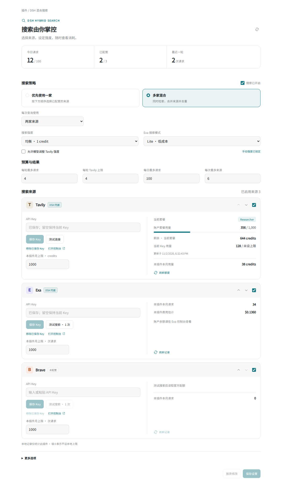

# DSH 混合搜索

在 DeepSeek Harness 里统一使用 **Tavily、Exa 和 Brave Search**。选择一家省着搜，或同时检索多家、合并去重。Key、强度、预算和用量，都在 DSH 的插件页里管理。

个人维护的非官方插件，与 DeepSeek、Tavily、Exa、Brave 无隶属关系。



*配置页预览，截图中的用量为演示数据。界面支持中文、英文和深色模式。*

## 安装

需要 DSH **0.2.1-rc.5** 或兼容的 0.2.x 版本，Node.js 22.19+ / 24+。本版针对 rc.5 的实际宿主接口验证。

在 **插件 → 添加插件 → 安装第三方插件** 中填写：

```text
github:MIKUSCAT/dsh-web-search-tavily
```

命令行也可以：

```powershell
dsh plugin --profile desktop add "github:MIKUSCAT/dsh-web-search-tavily"
```

完整退出并重新打开 DSH，然后打开 **插件 → DSH 混合搜索**。在各供应商卡片中填写 API Key、点击 **保存 Key**，再测试连接。

前端已经编译并随仓库发布，安装时不用构建前端，也不用部署搜索服务器。搜索直接由 DSH 后端调用供应商。

### 从 0.2.x 升级

插件已由 Tavily 单一搜索升级为混合搜索，版本为 **0.3.0**。仓库地址、包名 `dsh-web-search-tavily` 和宿主节点 `web-search-tavily` 继续保留，方便现有安装升级。

若旧安装仍显示 0.2.x，在插件管理页移除旧包，再从上面的 GitHub 地址安装。已有的环境变量和 DSH 凭据不会被插件删除。原来的 Tavily `apiKeyEnv`、`searchDepth`、主题、域名过滤等字段仍然可用。

安装补丁会把原生 `web_search` 设为 `hybrid-search`。如果你的 profile 以前手动固定了另一个搜索提供方，页面会出现 **设为 DSH 网页搜索**；点击即可切换。网页抓取继续使用 `http`。

## 怎么选搜索方式

| 方式 | 行为 |
|---|---|
| 优先使用一家 | 按卡片顺序选择已配置且有可用额度的来源，一次查询只调用一家。 |
| 多家混合 | 对同一查询使用前两家或三家已配置的来源，交错合并结果、去除重复 URL。 |
| 失败时切换下一家 | 优先模式下的可选功能，默认关闭。启用后，凭据、配额或网络错误可触发下一家；额外请求同样计入预算。 |

用卡片右上角的箭头调整优先级，用勾选框停用某一家。没有 Key 的供应商不会参与搜索。

**Tavily 强度默认由你锁定。** `basic`、`fast`、`ultra-fast` 每次 1 credit，`advanced` 每次 2 credits。勾选“允许模型调整 Tavily 强度”后，模型才可以覆盖它，累计预算仍然有效。Exa 可手动选择 `lite`、`auto` 或 `deep`，默认 `lite`。Brave 使用 Web Search API；选择新闻类别时使用 News API。

调小结果数主要减少返回内容与模型上下文；Tavily 的 basic 单次费用仍为 1 credit。多家混合会分别消耗各家的额度。

## Key、测试和额度

| 供应商 | 测试按钮做什么 | 可以显示什么 |
|---|---|---|
| Tavily | 用 `GET /usage` 验证认证连接，不执行搜索。 | 官方套餐名称、账户套餐用量、当前 Key 用量及上限、套餐剩余额度、按量付费用量。 |
| Exa | 执行一次 `lite` 搜索，只取 1 条结果。 | 本插件请求次数、搜索响应 `costDollars.total` 返回的费用估计。账户余额通过控制台查看。 |
| Brave | 执行一次搜索，只取 1 条结果。 | 最近一次响应头中的配额、剩余量、重置时间，以及本插件请求次数。 |

Exa 和 Brave 的按钮明确标为 **测试搜索 · 1 次**，会消耗一次请求。Tavily 的成功提示明确写“认证连接成功”；这不代表已经执行过搜索。

Tavily 的“刷新额度”调用账户用量接口；Exa 和 Brave 的“刷新记录”只读取本地及已收到的信息，不偷偷执行新的计费搜索。打开页面时自动读取一次 Tavily 额度；页面内每 10 秒刷新本地状态。

普通 Exa 搜索 Key 不能查询完整账户余额或套餐；其 Team Management 用量接口需要单独开通并使用 Service Key。本插件不把免费赠额或本地估算冒充官方余额。Brave 响应头未提供套餐名称时，也不猜测套餐等级。未知费用显示 `—`，已返回的费用明确标为估计。

Key 保存到 DSH 的凭据服务，下一次请求立即生效。输入框保存后清空，读取接口只返回是否配置与来源。托管凭据优先于启动环境变量及 `.env`；无需手动设置系统环境变量。仍可继续使用原来的 `TAVILY_API_KEY`、`EXA_API_KEY`、`BRAVE_API_KEY`。

“移除已保存 Key”删除托管值。如果环境变量或旧版 `apiKey` 仍然提供 Key，卡片会显示当前来源，并说明后备凭据仍存在。旧版直接填写的 Tavily `apiKey` 仅在凭据服务未提供值时使用。

申请 Key：[Tavily](https://app.tavily.com/) · [Exa](https://dashboard.exa.ai/) · [Brave](https://api-dashboard.search.brave.com/)

## 预算如何生效

默认设置：

| 项目 | 默认上限 |
|---|---:|
| 每轮实际发出的搜索请求 | 4 次 |
| 每轮 Tavily 消耗 | 4 credits |
| 每日实际发出的搜索请求 | 100 次 |
| 每次返回的来源 | 6 条 |
| 本插件每月 Tavily 消耗 | 1,000 credits |
| 本插件每月 Exa / Brave 请求 | 各 1,000 次 |

“每轮”指一个 DSH Agent 从本次输入到完成回答的整个 turn，包含期间所有搜索工具调用。原生 `web_search` 一次传入多个查询时，每条查询、每个供应商都分别计数。`hybrid_search` 和兼容的 `tavily_search` 共用限制。

请求发出前先预留额度，并发调用也不能越过上限。超限部分返回明确的预算提示，已经取得的来源继续返回，不会因为同批其他查询超限而丢掉有用结果。模型应使用已有结果回答；提高预算由你在界面操作。

每日和每月本地上限可填 `0` 关闭；每轮限制保持启用。统计周期按运行 DSH 的本机日期计算。月统计按供应商及 Key 的摘要区分，日统计合计此 DSH 主目录下的插件调用。文件锁协调同机多个 DSH 进程，重启不会清空日/月计数。

本地记录只覆盖此插件，无法统计同一个 Key 在其他程序中的调用。供应商账户的付费上限仍应在其控制台设置。请求已发送后发生超时或网络中断，Tavily 额度按本次强度保守计入并标记未确认，避免将取消误当成免费；明确的 HTTP 拒绝不计 Tavily credits，但仍计入本地请求次数。

## 更多选项

可设置搜索类别、时间范围、域名包含/排除、结果缓存、超时、Tavily 摘要片段和 Brave 请求间隔。新闻类别适配三家供应商；金融分类为 Tavily 专有参数。

- Tavily / Exa 默认只在内存缓存 120 秒，可设为 `0` 关闭；换 Key 后不会复用旧 Key 的结果。
- 同一轮中相同的在途查询共用一次请求；一个调用者取消不会取消其他调用者仍在等待的请求。
- Brave 不保存结果缓存，只合并在途重复查询。默认请求间隔为 1 秒，可按自己的计划调整。
- 时间、域名过滤在供应商请求中设置，并对返回域名再次过滤。
- 设置修改先保留在草稿中，点击“保存设置”才写入；并发修改发生冲突时保留你的草稿。

## 工具与宿主

原生 `web_search` 继续显示 DSH 的搜索结果卡片。插件另外提供 `hybrid_search` 和兼容的 `tavily_search`，参数为 `query`，以及可选的 `depth`、`topic`、`timeRange`、`maxResults`。直接调用 Tavily 同样遵守来源启用、暂停、强度锁和预算。Agent 如果使用工具白名单，需要自行把额外工具加入名单；原生工具无需更名。

旧 profile 固定的 `searchProvider: tavily` 仍能使用受同样预算控制的 Tavily 路由；改成 `hybrid-search` 后使用混合策略。`registerTool: false` 可只保留 provider 与原生 `web_search`。

界面通过 DSH 自带的 Connection RPC 通信，Key 通过宿主凭据服务读写，设置通过原生配置表单保存。没有额外监听端口，桌面版和网页版共用接口。管理接口只接受宿主 owner。卸载时会移除搜索提供方、额外工具、管理接口和前端样式。

用量文件：`$DSH_HOME/hybrid-search/usage.json`，默认在 `~/.dsh/hybrid-search/usage.json`。仅保存计数、费用估计和 Key 摘要，不保存搜索词、来源正文或明文 Key。供应商额度快照与连接测试状态仅保存在内存中。配置页不向聊天模型发送 Key。

## 开发与验证

```sh
npm ci --ignore-scripts
npm run check
npm pack --dry-run
```

`check` 包含 TypeScript 检查、前端构建和 Node 测试。测试使用虚拟 Key、临时目录及模拟供应商响应，不消耗真实搜索额度；依赖缺失会失败，不会把整套测试跳过。

测试覆盖三家请求格式、搜索锁定、混合去重、并发预算、跨进程用量文件、取消、缓存、错误脱敏、Key 管理和界面交互。宿主集成测试直接加载 DSH rc.5 的 Connection、凭据、WebRuntime、ToolRuntime 与原生 `web_search`，验证真实工具管线和卸载。真实账户认证与所在网络的可达性，在安装后用卡片里的测试按钮验证。

`lib/client.js` 是 DSH 模块加载器使用的已编译前端，随仓库提交。修改 `client/` 后执行 `npm run build`，提交源码与编译结果。

接口依据：[Tavily Search](https://docs.tavily.com/documentation/api-reference/endpoint/search) · [Tavily Usage](https://docs.tavily.com/documentation/api-reference/endpoint/usage) · [Exa Search](https://exa.ai/docs/reference/search) · [Exa Team Usage](https://exa.ai/docs/reference/team-management/get-api-key-usage) · [Brave Search](https://api-dashboard.search.brave.com/api-reference/web/search/get) · [Brave 配额响应头](https://api-dashboard.search.brave.com/documentation/guides/rate-limiting) · [DSH 源码](https://github.com/deepseek-ai/deepseek-harness/tree/dsh-v0.2.1-rc.5)

## 许可证

[MIT](LICENSE) © 2026 MIKUSCAT
